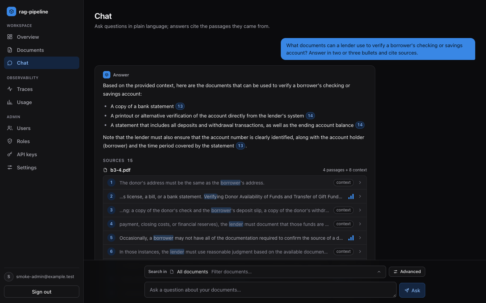
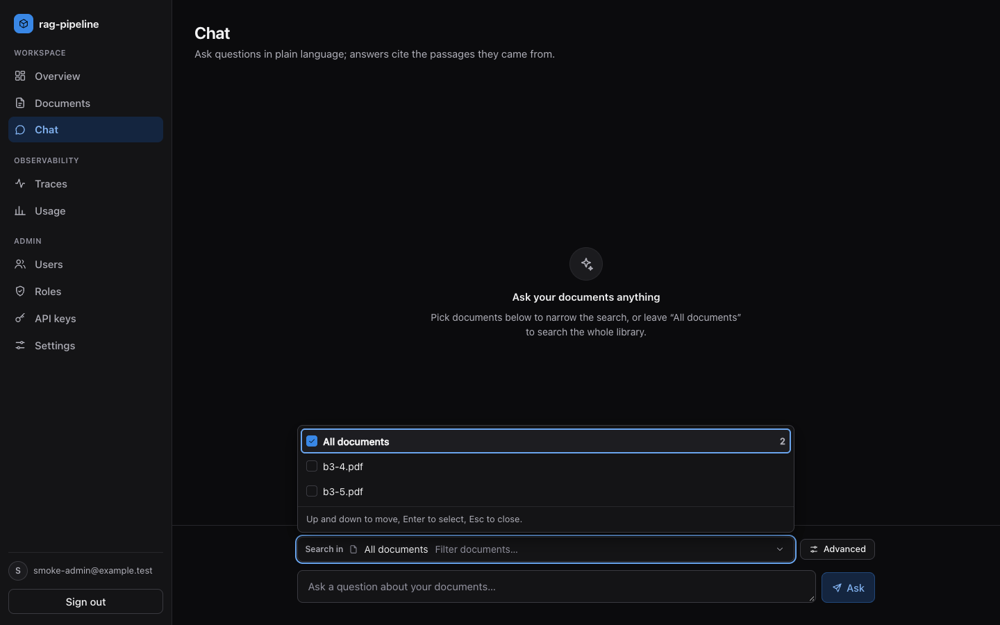
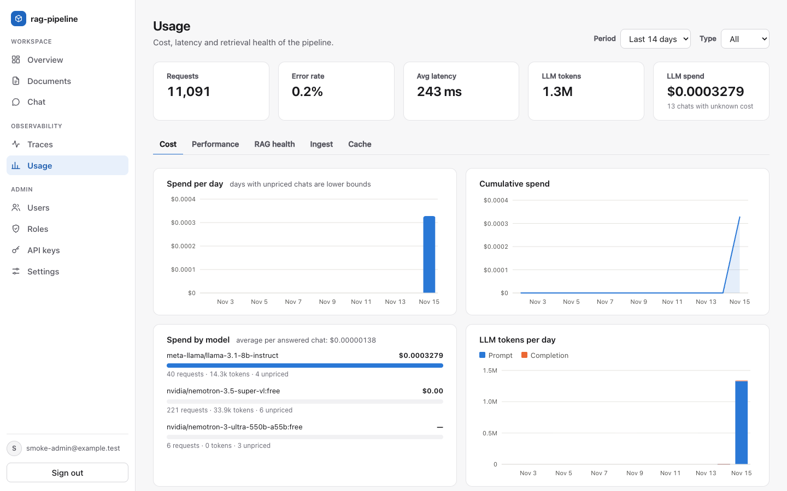
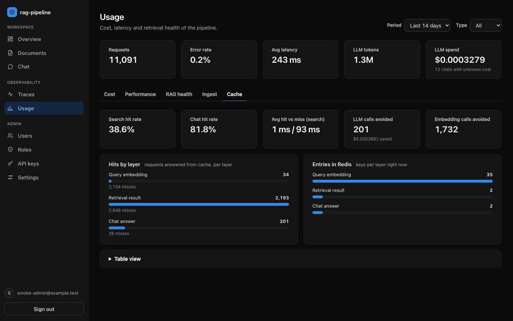
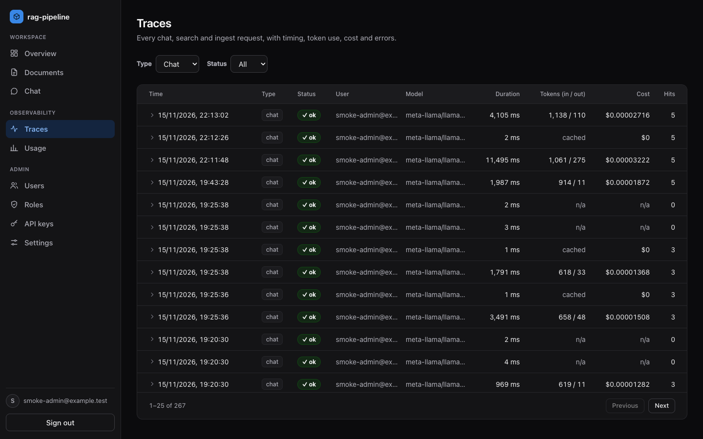
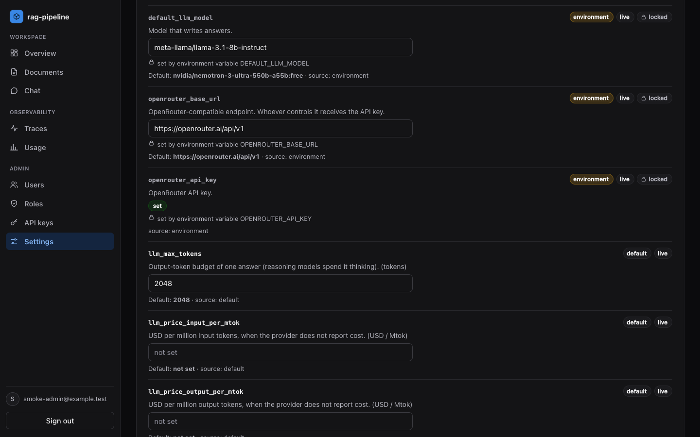
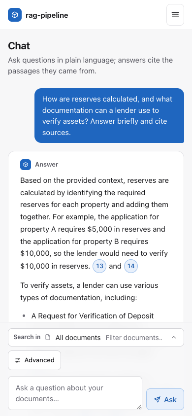
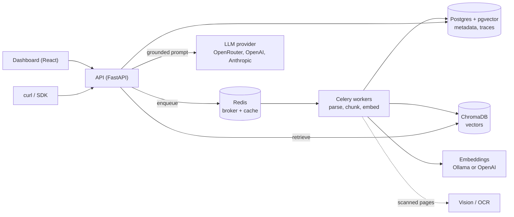

# rag-pipeline

**A self-hostable RAG pipeline: upload documents, get cited answers, and see what every answer costs.**
FastAPI, Celery, Postgres/pgvector, ChromaDB and a React dashboard. Runs on a laptop with Docker Compose and on Kubernetes with Kustomize.

[](https://github.com/aayushjoshi-12/rag-pipeline/actions/workflows/ci.yml)
[](LICENSE)
[](https://github.com/aayushjoshi-12/rag-pipeline/releases)
[](https://github.com/aayushjoshi-12/rag-pipeline/pkgs/container/rag-pipeline-backend)



## Why this exists

- **Most RAG demos stop at "it answered".** This one also parses real PDFs and Word files, updates documents incrementally, caches repeated questions, and records tokens and cost for every request.
- **The same code runs everywhere.** One `make up` on a laptop, the same images behind Kubernetes with autoscaling, and an API-only mode when you bring your own UI.
- **You pick the parts.** Chat model, embeddings, vision parser, vector store, retrieval mode and chunking are settings (editable at runtime in the dashboard), not code changes.
- **It tells you what it has and has not been tested on.** See [Status and limits](#status-and-limits).

## Features

**Ingest and parsing**
- Upload pdf, docx, txt or md, or ingest from an `https://` or `s3://` link; workers parse, chunk, embed and index with pollable job status ([API](docs/api.md)).
- PDFs use their own text layer when they have one (free and fast); only scanned pages go to a vision model or Tesseract OCR; DOCX goes through docling ([ADR-0002](docs/adr/0002-document-parsing.md)).
- Content-defined chunking: editing a document re-embeds only the chunks that changed ([ADR-0003](docs/adr/0003-chunking.md)).
- Local-disk or S3-compatible file storage ([configuration](docs/configuration.md#file-storage-and-url-ingest)).

**Retrieval and chat**
- Semantic, keyword (BM25) and hybrid search with rank fusion; Chroma or pgvector, with HNSW / IVFFlat options ([configuration](docs/configuration.md#retrieval-modes)).
- Streaming chat over Server-Sent Events with inline citations, sources grouped by document and neighbour context ([ADR-0006](docs/adr/0006-chat-streaming-sse.md)).
- `POST /search` returns ranked passages with no LLM call, for teams that bring their own model ([API](docs/api.md#post-search---ranked-passages-no-llm)).
- A three-layer Redis query cache (embedding, retrieval, answer) that fails open if Redis is down ([ADR-0004](docs/adr/0004-query-cache.md)).

**Observability and cost**
- Traces for every chat, search and ingest request: duration, tokens, cost, cache hits, errors.
- Usage pages for spend per day and per model, latency, retrieval health, ingest and cache effectiveness ([configuration](docs/configuration.md#llm-cost-and-the-usage-page)).
- Optional Langfuse tracing. Question text is stored only when you enable it.

**Operations and deployment**
- Docker Compose for local use, Kustomize overlays (`dev`, `prod`, `kind`, `headless`) with HPAs for Kubernetes ([deployment](docs/deployment.md#kubernetes-overview)).
- Multi-arch images (amd64, arm64) built by a release workflow with Trivy, SBOM and provenance ([deployment](docs/deployment.md#published-images)); none are published until the first release.
- Compose memory limits per container, health endpoint, idempotent migrations that run before the app starts.

**Security and admin**
- JWT login, admin-defined roles and permissions checked on every request, and revocable API keys for services ([ADR-0007](docs/adr/0007-api-keys.md)).
- Admin Settings window: change providers, models and tunables at runtime; provider keys are write-only and stored encrypted ([ADR-0008](docs/adr/0008-runtime-settings.md)).
- Versioned `/v1` API with a committed OpenAPI contract and a test that fails on breaking changes ([ADR-0005](docs/adr/0005-api-versioning-and-contract.md)).

## Quickstart

You need Docker with Compose. Embeddings default to a local [Ollama](https://ollama.com) on the host:

```bash
ollama pull mxbai-embed-large     # once; containers reach it at host.docker.internal:11434
```

Chat and (optional) vision parsing need a provider key, for example an [OpenRouter](https://openrouter.ai) key. You add it in the dashboard, so it never has to live in a file. To use hosted embeddings instead of Ollama, change the embedding provider in Admin > Settings.

**(a) From source** (builds the images from this checkout):

```bash
git clone https://github.com/aayushjoshi-12/rag-pipeline.git && cd rag-pipeline
cp .env.example .env
# fill the four blanks in .env: SECRET_KEY and SETTINGS_ENCRYPTION_KEY (each: python3 -c 'import secrets; print(secrets.token_urlsafe(48))'),
# plus ADMIN_EMAIL and ADMIN_PASSWORD for the first admin
make up
```

Open the dashboard at http://localhost:5173 (API docs at http://localhost:8000/docs), sign in with your admin, then **Admin > Settings**: add your LLM provider key and click "Test connection". Upload a document on **Documents**, wait for `ready`, and ask a question on **Chat**. `make down` stops the stack and keeps your data.

**(b) Published images** (no build toolchain; `v0.1.0` images for linux/amd64 and linux/arm64 are on GHCR):

```bash
git clone https://github.com/aayushjoshi-12/rag-pipeline.git && cd rag-pipeline
cp .env.example .env              # fill the same four values as above
docker compose -f docker-compose.image.yml up -d    # or: make up-image; pin a version with RAG_VERSION=0.1.0
```

Same services and ports as (a). Details, tags, upgrades and Kubernetes image overrides: [docs/deployment.md](docs/deployment.md). Single-quote values in `.env` that contain `& ; ! $`. Locked out? `docker compose exec api python -m app.manage create-admin --email you@example.com`.

## Screenshots

| | |
|---|---|
|  Narrow a question to chosen documents. |  Spend per day and per model (light theme). |
|  Cache hit rates, LLM and embedding calls avoided. |  Every request with tokens, cost and cache status. |
|  Settings with env-locked values and write-only secrets. |  The dashboard works at phone width. |

The screenshots use two public Fannie Mae Selling Guide chapters (not bundled in this repository) and a throwaway local account.

## Architecture



The API only accepts uploads and enqueues work; workers do the heavy lifting, so API and workers scale independently. The full diagram, deployment matrix and design boundaries are in [docs/architecture.md](docs/architecture.md).

## Call it from code

Log in, search (no LLM involved) and ask a question. More examples (upload, poll a job, API keys, JavaScript) are in [docs/api.md](docs/api.md#end-to-end-examples).

```bash
API=http://localhost:8000
TOKEN=$(curl -sf "$API/v1/auth/login" -H 'content-type: application/json' \
  -d '{"email":"you@example.com","password":"your-password"}' | jq -r .access_token)

curl -sf "$API/v1/search" -H "Authorization: Bearer $TOKEN" -H 'content-type: application/json' \
  -d '{"query":"how are reserves calculated","top_k":3}' | jq '.results[] | {rank, filename, text: .text[:80]}'

curl -sf "$API/v1/chat" -H "Authorization: Bearer $TOKEN" -H 'content-type: application/json' \
  -d '{"question":"How are reserves calculated?","top_k":3}' | jq '{answer, sources: (.sources | length)}'   # calls your LLM provider
```

```python
import httpx

client = httpx.Client(base_url="http://localhost:8000", timeout=60)
token = client.post("/v1/auth/login", json={"email": "you@example.com", "password": "your-password"}).json()["access_token"]
client.headers["Authorization"] = f"Bearer {token}"  # services: client.headers["X-API-Key"] = "rag_..."

hits = client.post("/v1/search", json={"query": "how are reserves calculated", "top_k": 3}).json()
for hit in hits["results"]:
    print(hit["rank"], hit["filename"], hit["text"][:80])
```

## By the numbers

Measured on one laptop (Apple M4) with real Fannie Mae Selling Guide chapters; method, raw data and caveats in [docs/performance.md](docs/performance.md).

- **~10x faster repeat searches** (50 ms -> 5 ms median) and **chat answers in ~25 ms instead of ~3 s, free, when cached**, without ever serving stale data.
- **A 50-page PDF is searchable in ~20 seconds**; editing a document re-embeds only the chunks that changed (46% of chunks stayed identical between two real versions, vs 1% with fixed-size chunking).
- **A chat answer costs ~$0.00001** on a small model (roughly 70,000 answers per dollar); local embeddings are free.
- **Sources appear in under 0.25 s** while the answer streams.
- **Autoscaled 2 -> 8 API pods on a laptop Kubernetes cluster**, 13,254 searches in 4 minutes, **zero errors**; settings changes reach every replica in under 3 s.
- **If Redis dies, the app keeps answering** (uncached, ~50 ms) and heals itself; 1,400+ backend and 300+ frontend tests, key ones mutation-checked.

## Deployment

| Target | Command | Docs |
|---|---|---|
| Docker Compose, from source | `make up` | [deployment.md](docs/deployment.md) |
| Docker Compose, published images | `docker compose -f docker-compose.image.yml up -d` | [deployment.md](docs/deployment.md#run-the-published-images) |
| HTTPS (Ingress TLS, or the frontend image on :8443) | `make up-image-tls` (certs in `./certs`) | [deployment.md](docs/deployment.md#https) |
| Kubernetes (Kustomize overlays `dev`, `prod`, `kind`) | `make deploy ENV=dev` (render only: `make deploy-dry ENV=prod`) | [deployment.md](docs/deployment.md#kubernetes-overview), [kubernetes-local.md](docs/kubernetes-local.md) |
| Headless (API only, no dashboard) | `k8s/overlays/headless`, or `make up-api` on Compose | [api.md](docs/api.md#headless-deployment-api-only) |

## Status and limits

Verified means observed on a running stack with real dependencies; the full table is in [docs/status.md](docs/status.md).

| Area | State |
|---|---|
| Ingest, parse (native PDF text, OCR, DOCX, txt/md), chat with citations, streaming, search modes, cache, auth and RBAC, Settings window, traces and usage | Verified on Docker Compose with real Postgres, Redis, Chroma, Ollama and OpenRouter |
| Kubernetes on kind (all pods, migrations, login, ingest, chat, HPA 2 -> 8, pod-delete survival, S3 mode) | Verified on kind, arm64 images |
| Compose-from-clean-clone and local image build and run | Verified on Apple Silicon (arm64) |
| Vision parsing of scanned pages with a live provider call | Partial: passed in earlier runs, not re-run after the switch to pypdfium2 |
| Release workflow and published images (v0.1.0) | Ran on GitHub: multi-arch (amd64 + arm64) images built, Trivy-scanned, pushed to GHCR with a verified SLSA provenance attestation; the published images were pulled anonymously and run (login, ingest, all three search modes, dashboard and API proxy). Its last step failed once because the release had been created by hand (fixed) |
| In-cluster Ollama, a real ReadWriteMany storage class, the untrimmed `prod` replica counts | Not run |
| Worker throughput with many workers, Chroma beyond ~3k vectors per collection | Not measured |
| Retrieval quality | Measured on one corpus with 12 labelled questions: hybrid did not beat keyword-only there. Treat as indicative |
| Known gaps | No login rate-limiting, no per-user document ownership, tokens are not revocable before expiry beyond deactivating the user |

Benchmarks are laptop numbers, not capacity planning. Until version 1.0 the API and settings may change between minor versions ([CHANGELOG](CHANGELOG.md)).

## Documentation

[Documentation index](docs/README.md): [architecture](docs/architecture.md), [HTTP API](docs/api.md), [configuration](docs/configuration.md), [deployment](docs/deployment.md), [Kubernetes on kind](docs/kubernetes-local.md), [performance](docs/performance.md), [status](docs/status.md) and the [decision records](docs/adr/).

## Contributing

Issues and pull requests are welcome. Setup, conventions and the PR checklist are in [CONTRIBUTING.md](CONTRIBUTING.md); `make check` runs lint, strict typing and the test suites (backend and frontend). Coding agents: [AGENTS.md](AGENTS.md). Please follow the [Code of Conduct](CODE_OF_CONDUCT.md).

## Security

Report vulnerabilities privately as described in [SECURITY.md](SECURITY.md). Do not open public issues for them.

## Data and privacy

Documents are processed on your own infrastructure. Embeddings go to your own Ollama by default; chat (and optional vision parsing) calls go only to the provider you configure, with the retrieved passages in the prompt. This project adds no telemetry of its own, Langfuse tracing is opt-in, and question text is stored in traces only when you enable it. The Fannie Mae Selling Guide chapters used for benchmarks and screenshots are public documents and are not bundled here.

## License

[MIT](LICENSE) (c) 2026 Aayush Joshi.
