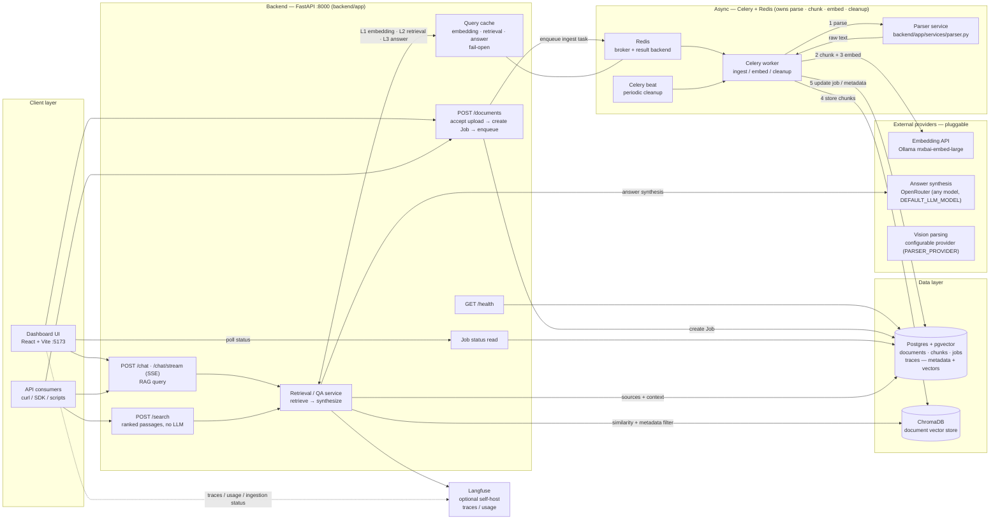

# Architecture

System diagram for `rag-pipeline`. Two primary user-facing flows — **ingest** (upload →
indexed) and **query** (question → answer + sources) — plus scheduled cleanup, all behind one
FastAPI backend with horizontally-scaling async workers.

## Deployment matrix

| Concern | Local dev (Compose) | Prod (Kubernetes) |
|---|---|---|
| API | 1 container `:8000` | Deployment + ClusterIP svc + HPA (2–8) |
| Workers | 1 container (+ 1 beat container) | Deployment + HPA (2–8), same image (+ beat Deployment) |
| Postgres+pgvector | compose volume | PVC-backed Deployment |
| Redis | compose | Deployment + service |
| ChromaDB | compose (Chroma **server**, host port 8001; or `VECTOR_STORE=pgvector`) | Deployment + PVC (Chroma server) |
| Dashboard | Vite dev `:5173` (Compose `ui` profile: `make up`) | nginx image serving the built SPA, behind an Ingress (`k8s/overlays/prod`) |
| Secrets | `.env` (dev) | K8s `Secret` (prod) |
| Query cache | Redis db 12 (same container) | Redis db 12 (`CACHE_REDIS_URL` in the ConfigMap) |
| API contract | `/v1`, snapshot in `docs/openapi.json` | same; `k8s/overlays/headless` serves the API without the dashboard |

## Design boundaries

- **The API never parses, chunks, embeds, or cleans up.** Its only job on ingest is to accept
  the upload, record the Job, and enqueue a Celery task. All document processing lives in the
  async worker path. A dashboard surface to inspect/manage parsing output may come later — it
  reads state; it doesn't get a parse/embed API.
- The same backend image runs the API **and** the worker — the difference is only the container
  command (`uvicorn` vs `celery -A app.celery_app worker`).
- Parsing is original code in `backend/app/services/` (seam `app/services/parser.py`), so the
  pipeline is self-contained.
- ChromaDB runs as a server in every environment (the `chroma` Compose service / K8s Deployment, over HTTP); the app
  can instead keep vectors in Postgres (`VECTOR_STORE=pgvector`, [ADR-0001](adr/0001-stack.md) addendum). The founding
  context's "embedded Chroma" idea (D1 in `context/v0/README.md`) was not implemented.
- Scaling is the headline capability: API and workers scale horizontally behind Redis-backed
  Celery tasks; no shared-state coupling beyond the datastores.
- **The query cache is an optimisation, never a dependency.** Redis down or slow means requests are served uncached; ingest, delete, replace and reindex invalidate it ([configuration](configuration.md#query-cache), [numbers](performance.md)).
- **Auth always runs before the cache.** Keys contain no user identity because the corpus is shared.
